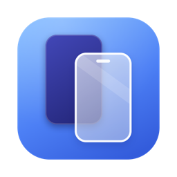

<p align="center">
  
</p>

<h1 align="center">Visor</h1>

<p align="center">
  Espelhe e controle seu Android pelo Mac, sem terminal.<br>
  Uma interface nativa para o <a href="https://github.com/Genymobile/scrcpy">scrcpy</a>.
</p>

---

## O que faz

- **Lista os celulares conectados** por USB ou Wi-Fi, com modelo, tipo de conexão e estado. Avisa quando falta autorizar a depuração USB.
- **Espelha com um clique.** A tela do celular abre numa janela no Mac e você usa mouse e teclado nela.
- **Ajusta a qualidade:** resolução máxima, bitrate, FPS, codec (H.264, H.265, AV1) e áudio.
- **Opções úteis:** desligar a tela do celular durante o espelhamento, manter acordado, mostrar toques, sempre no topo, sem borda, tela cheia e só visualizar.
- **Grava a tela** em `~/Movies/Visor`.
- **Usa a câmera do celular** como fonte de vídeo (Android 12+).
- **Presets** prontos (Padrão, Leve para Wi-Fi, Gravação, Apresentação) e os seus. O app lembra qual preset cada celular usa.
- **Wi-Fi:** liga o modo sem fio de um celular plugado, conecta por IP, pareia com código (Android 11+) e lembra os últimos IPs.
- **Ações rápidas:** print da tela na Mesa, instalar APK e enviar arquivos, pelos botões ou arrastando para a janela.
- **Barra de menus** com os celulares e o botão de espelhar.
- **Log** de cada sessão para quando algo dá errado.

## Requisitos

- macOS 14 ou mais novo, em Apple Silicon ou Intel.
- Um Android com a **Depuração USB** ligada.

Não precisa instalar `adb` nem `scrcpy`: o build baixa a versão oficial do scrcpy para macOS, que já traz o `adb`, e coloca tudo dentro do app.

## Compilar e instalar

Só precisa das ferramentas de linha de comando do Xcode (`xcode-select --install`).

```sh
./build.sh            # gera o Visor.app nesta pasta
./build.sh install    # também copia para /Applications e abre
./build.sh icon       # redesenha o ícone a partir de Tools/make-icon.swift
```

A versão do scrcpy fica na variável `SCRCPY_VERSION`, no topo do `build.sh`.

Para conferir se o `adb` e o `scrcpy` embutidos funcionam, sem abrir janela:

```sh
Visor.app/Contents/MacOS/Visor --check
```

## Primeiro uso

1. No Android, abra **Configurações › Sobre o telefone** e toque 7 vezes em **Número da versão** para liberar as Opções do desenvolvedor.
2. Em **Opções do desenvolvedor**, ligue a **Depuração USB**.
3. Plugue o cabo e aceite o pedido de autorização que aparece no celular.
4. O celular aparece no Visor. Clique em **Espelhar**.

Para usar sem fio, com o celular ainda no cabo, abra **Wi-Fi** e escolha **Ativar Wi-Fi neste celular**. Depois pode tirar o cabo.

## Limites

- A janela do vídeo é a do próprio scrcpy, não uma janela nativa do macOS.
- Algumas opções dependem do controle do celular e são ignoradas no modo "só visualizar" e no modo câmera (desligar a tela, manter acordado, mostrar toques, teclado e mouse físicos).

## Créditos e licença

O espelhamento é feito pelo [scrcpy](https://github.com/Genymobile/scrcpy), da Genymobile, distribuído sob a licença Apache 2.0. A licença dele vai junto no app, em `Contents/Resources/scrcpy-LICENSE.txt`.

O código do Visor está sob a licença [MIT](LICENSE).
